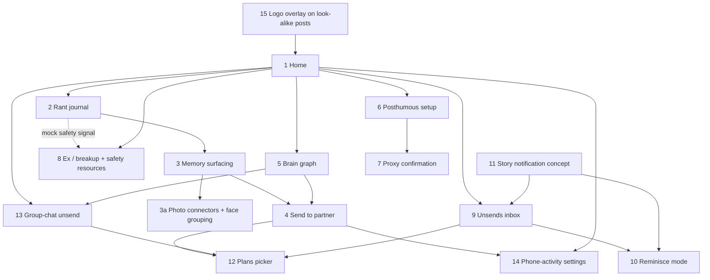

# Unsaid: Frontend Build Spec

### *A clickable UI shell for every screen, with nothing wired up yet.*

**HackTX 2026 · Meta track: "Bringing People Closer Together with AI"**
Companion to `Unsaid_Product_Spec.md` (v5), `Demo_Script.md`, and **`Claude_Code_Frontend_Prompt.md`** (v2: the phased, ready-to-paste Claude Code prompt that builds this spec) and **`BACKEND_REQUESTS.md`** (frontend → backend requests for Mudit).

**Purpose:** tell Claude (Claude Code) exactly how to build the Unsaid frontend as a clickable, mock-data-only UI shell, and give Mudit (backend owner) one table of every button he will wire up later.

**Spec version: v3** · Oct 24, 2026

> ## "The last thing my kid ever texted me was 'k.'"
>
> The cold open of the animated demo (Scene 1). Every screen below exists so that text never has to be the last one.

---

## Table of Contents

1. [The One Rule: Frontend Only](#1-the-one-rule-frontend-only)
2. [Mock Data](#2-mock-data)
3. [Design System](#3-design-system)
4. [Tech Stack](#4-tech-stack)
5. [Folder Structure](#5-folder-structure)
6. [Component List](#6-component-list)
7. [Navigation Map](#7-navigation-map)
8. [Screens](#8-screens)
9. [The Frontend-Backend Contract](#9-the-frontend-backend-contract)
10. [Ready-to-Paste Prompt for Claude](#10-ready-to-paste-prompt-for-claude)
11. [Changelog](#11-changelog)

---

## 1. The One Rule: Frontend Only

This build is a **UI shell**. It looks and moves like the real app, but **no feature works**.

- **Every action button is a non-functional placeholder, marked NOT YET CONNECTED.** That means three things on every one of them:
    1. **A visible marker:** a small pill badge reading `NOT YET CONNECTED` in the button's top-right corner (amber outline, 9px uppercase), plus a tooltip on hover: "not connected yet · `<feature-id>`".
    2. **A data attribute:** `data-backend="<feature-id>"`, using the exact kebab-case ID from the [contract table](#9-the-frontend-backend-contract).
    3. **A toast-only click handler:** `onClick` does one thing: it shows a soft toast, **"Not connected yet"**, with the feature ID in small text underneath. No fetch, no state change, no navigation, no `tel:` or `sms:` links.
- **All data is hard-coded mock data** in `frontend/lib/mock/`. No API calls, no environment keys, no auth, no camera, microphone, or photo access.
- **Navigation is the only thing that works.** The tab bar, back chevrons, the screen switcher, and swipe/tap gestures that only move between mock screens or mock story cards are plain frontend routing. They are listed separately in [Section 9.2](#92-navigation-only-controls-not-backend) and carry no badge.
- **Two attributes.** From v2, every placeholder carries both `data-backend` and an identical alias, `data-feature-id`. Tests and the later animation may use either one.
- **Badges can be hidden for recording.** A single flag (`?badges=off` in the URL, or `NEXT_PUBLIC_SHOW_BADGES=false`) hides the pills so the same screens can be recorded or rendered in Remotion. The `data-backend` attribute and the toast stay either way.
- **Honesty about Meta surfaces (v2).** Screens 11 and 15 and the fake Meta apps (Section 4.1) are **concept screens**. A real version would need a partnership with Meta and access beyond its public APIs. Every Apple and Meta app icon and screen is a **look-alike recreated in SVG/CSS** (brand-colored gradient plus a simple drawn glyph), and real app names (Instagram, WhatsApp, Facebook, Messenger, Threads, Meta AI, Edits) may appear **as plain text**. **Never** download or embed official logo files, app icons, wordmarks, glyph files, screenshots, or proprietary fonts (SF Pro, Optimistic). Each such page carries a small "concept · look-alike" label, plus "concept mock · not affiliated with Apple or Meta" outside the device. *Risk note:* recognizable look-alikes of trademarked icons are still a trademark gray area. Fine for a labeled hackathon concept; never ship them.
- **Navigation is real, the scripted animation is not part of this build.** App-to-app navigation runs through an interactive **iOS navigation shell** (Section 4.1). The scripted demo animation is out of scope here and will come in a separate prompt later (timings are saved in `Demo_Script.md`).
- **Features follow the backend.** Read (never edit) `backend/` as Mudit builds it. Backend features missing from the frontend are added to the app and to Section 9 with a new ID; anything not built on the backend stays a placeholder. The build ends with a report of every button that still has no backend (feature ID, screen, label).

**Placeholder button reference (copy this pattern):**

```tsx
<PlaceholderButton featureId="rant-record" variant="primary">
  hold to talk
</PlaceholderButton>
// renders: <button data-backend="rant-record" ...>hold to talk<NotConnectedBadge/></button>
// onClick: toast("Not connected yet", { description: "rant-record" })
```

---

## 2. Mock Data

All of it lives in `frontend/lib/mock/` as typed TypeScript objects. Avatars and photos are soft illustrated placeholders (generate them; never use real people's photos).

| Kind | Mock entries |
|---|---|
| **People** | **Mom** (calls a lot, "no emergency. just miss you."), **Dad** (called on tuesday, no call back yet), **Priya** (best friend, drifting: "4 months"), **Jordan** (partner, the argument) |
| **Group chats** | **Fam** (Mom, Dad, you), **Roommates** (Priya, you, two faded nodes), **Marfa Trip** (Priya, Jordan, you) |
| **Memories** | lake trip, june · mom's birthday dinner · moving-day selfie · marfa sunset · graduation photo · 2 AM laughing fit |
| **Brain-graph gaps** | "last talked: 2019" · "4 months" · "never replied" |
| **Unsends** | Mom: "no emergency. I just wanted to hear your voice." · Mom: "I'm so proud of you. I always was." · Jordan: "I'm sorry. Dinner Friday?" · Priya: "found these and miss you all. reunion soon?" |
| **Rant** | "I'm so tired of always being the one who reaches out…" (about Jordan, tone: frustrated) |
| **Plan** | Your old favorite taco spot · Friday, Nov 6 · 7:00 PM |
| **Posthumous** | June 12, 2034 · Graduation Day · proxies: Dad, Priya, Jordan |
| **Call log** | Mom: 10 missed calls · Dad: missed call, tuesday |

The user is "you" (the kid); where another person's phone needs a sender name, use the mock display name **Riley**. Mom's side of the story appears on the left screen of the Duo layouts where it helps.

---

## 3. Design System

Warm and minimal: a lamp, not a screen. It matches the Animated Demo Plan visual style in the product spec.

### 3.1 Color tokens

| Token | Value | Use |
|---|---|---|
| `accent` | `#E8A15A` (amber) | The one accent: key buttons, the moments that matter, the ripple ring |
| `accent-soft` | `#F6D3AE` | Accent backgrounds, selected chips |
| `ink` | `#4A1F35` (deep plum) | All primary text, icons, the logo gradient end |
| `ink-muted` | `#7A5A6A` | Secondary text, timestamps |
| `ink-faint` | `#B9A3AE` | Faded graph links, disabled text |
| `cream` | `#FBF5EC` | App background |
| `cream-deep` | `#F3E7D7` | Cards on cream, the brain-graph canvas ("dark cream") |
| `card` | `#FFFDF9` | Raised cards |
| `dusk-rose` | `#E9B7B4` | Gradient start |
| `peach` | `#F6C9A4` | Gradient middle |
| `line` | `#EADBCB` | Hairlines and card borders |
| `safety` | `#3E5C76` (calm slate) | Safety screens only; never red, never alarming |
| `badge` | `#E8A15A` outline on `#FFF4E8` | The NOT YET CONNECTED pill |

**Gradients**
- `bg-dusk`: `linear-gradient(180deg, #E9B7B4 0%, #F6C9A4 45%, #FBF5EC 100%)` (dusk rose → peach → warm cream). Sits behind the phone frames.
- `logo-gradient`: `linear-gradient(135deg, #E8A15A 0%, #4A1F35 100%)` (amber → deep plum).

### 3.2 Type

**Inter** for all interface text. **Caveat** (handwritten) for anything the user or a loved one actually wrote or said: unsend text, letters, rant quotes on cards. Load both from Google Fonts via `next/font`.

| Token | Font | Size / line height (px) | Weight | Use |
|---|---|---|---|---|
| `display` | Inter | 32 / 38 | 600 | Screen titles (rare) |
| `title` | Inter | 22 / 28 | 600 | Card headers |
| `body` | Inter | 16 / 24 | 400 | Default |
| `small` | Inter | 13 / 18 | 400 | Timestamps, captions |
| `micro` | Inter | 9 / 12 | 600, uppercase, 0.06em tracking | NOT YET CONNECTED badge, "concept" labels |
| `hand-lg` | Caveat | 34 / 40 | 500 | Letters, featured unsends |
| `hand` | Caveat | 24 / 30 | 500 | Unsend text in cards |

### 3.3 Radii, spacing, shadow

| Token | Value |
|---|---|
| `radius-sm` / `md` / `lg` / `xl` / `pill` | 10 / 16 / 24 / 32 / 999 px |
| Spacing scale (4px base) | 4, 8, 12, 16, 24, 32, 48, 64 |
| Screen padding | 24px sides, 32px top below the status bar |
| Gaps | 16px between cards; 32px between sections (generous whitespace, never cramped) |
| `shadow-card` | `0 8px 24px rgba(74,31,53,0.08)` |
| `shadow-float` | `0 20px 48px rgba(74,31,53,0.14)` (phone frames) |
| Frosted overlay circle | `rgba(255,255,255,0.35)` + `backdrop-filter: blur(10px)` |

### 3.4 Motion tokens

Nothing snaps; everything settles.

| Token | Value | Use |
|---|---|---|
| `ease-soft` | `cubic-bezier(0.22, 1, 0.36, 1)` | Default for everything |
| `ease-breath` | `cubic-bezier(0.45, 0, 0.55, 1)` | Loops: pulse, tide, waveform |
| `dur-fast` | 240ms | Hover, press, chip select |
| `dur-base` | 480ms | Card enter, sheet slide |
| `dur-slow` | 900ms | Screen fades, photo reveals |
| `dur-hold` | 1200ms | Big moments (the date card, the call connecting) |
| `fade-in` | opacity 0 → 1 over `dur-slow` | Default enter |
| `scale-in` | scale 0.96 → 1 plus fade, `dur-base` | Cards, photos |
| `spring-soft` | Framer Motion `{ type: "spring", stiffness: 120, damping: 20 }` | Sheets, notifications |
| `stagger` | 120ms between siblings | Photo grids, list items |
| `pulse-once` | scale 1 → 1.08 → 1 over 1200ms, `ease-breath` | The logo heartbeat |
| `ripple-ring` | ring scales 0.6 → 1.8, opacity 0.5 → 0, 900ms, amber | **The haptic**, shown visually |
| Reduced motion | Swap all motion for 200ms fades | `prefers-reduced-motion` |

**Sound and haptic (shown, not played):** a **soft chime** when an unsend lands and a **haptic pulse** when the phone-activity trigger delivers. In the shell both are drawn as the `RippleRing` component (one amber ring expanding from the notification or button), with an optional small chime icon. No audio plays in the UI shell; the Remotion render adds the chime.

### 3.5 Microcopy rules

- Short, human, lowercase, slightly imperfect. Run every line past "would a person say this?"
- Yes: "Mom left you something." · "you haven't talked in a while." · "no emergency. just miss you." · "that sounds exhausting." · "whenever you're ready."
- Never: "Strengthen your relationships today!" or anything that sounds like an ad.
- Names keep their capital (Mom, Priya). Safety resource names keep normal capitalization.

### 3.6 The Unsaid mark

A single-line speech-bubble outline **left slightly open** (the gap where the words never got said), inside a small rounded square as the app badge. Overlay version: a 24–28px white mark on a frosted, semi-transparent circle with a faint shadow. Wordmark: "unsaid" in lowercase, rounded sans; the dot of the "i" is the open bubble. Build it as an inline SVG component (`UnsaidMark`).

---

## 4. Tech Stack

| Layer | Choice | Notes |
|---|---|---|
| Framework | **React + Next.js (App Router) + TypeScript** | One route per screen |
| Styling | **Tailwind CSS** | Tokens from Section 3 go in `tailwind.config.ts` and CSS variables |
| UI motion | **Framer Motion** (with the **Motion AI Kit**, `npx motion-ai`, [docs](https://motion.dev/docs/ai-kit)) and/or **GSAP** ([gsap-skills](https://github.com/greensock/gsap-skills)) | Framer Motion for enters, sheets, and story transitions; GSAP only if a timeline gets complex |
| Brain graph | **react-force-graph** (2D) | Soft physics; custom canvas painting for photo leaves and gap labels |
| Toasts | `sonner` (or a small custom toast) | Only for "Not connected yet" |
| Demo video | **Remotion** (later, separate prompt) | Will render the demo MP4 from the **same screen components**; not installed in this build |
| Device | **Custom `IPhoneDuo`** component (white, fictional) | See the note below; snapcn Phone Frame is optional now |
| Fonts | Inter + Caveat via `next/font/google` | |

**The device: a white "iPhone Duo" (v2).**
- The **iPhone Duo is fictional**: a book-style, dual-screen iPhone with two iPhone-proportioned panels on a 360° hinge. **White is the default finish everywhere.** Folded, it reads as one white iPhone; unfolded, it shows two displays side by side with a white hinge between them. It is a custom React component drawn in CSS (`components/device/IPhoneDuo.tsx`) with full hardware detail: frame, bezel, Dynamic Island, hinge, buttons, Camera Control, a camera bump on the back, and specular gloss. The geometry is in `Claude_Code_Frontend_Prompt.md` Phase 1. No Apple bezel images are used.
- **`PhoneFrame` and `DuoFrame` now wrap `IPhoneDuo`.** `PhoneFrame` = one **folded** white Duo; `DuoFrame` = one **unfolded** white Duo, with its left/right display slots (plus a spanning slot across the hinge) replacing v1's "two frames side by side".
- **New layout `TwoPhones`:** two **folded** white Duos side by side (scale 0.86, 96px apart, captions underneath). Use it when a screen shows **two different people's phones** (Screens 4, 7, 11, 12, 14). Screen 15 uses three folded Duos.
- snapcn Phone Frame (v1) is no longer needed.

### 4.1 Opening, home screen, and the iOS navigation shell (v2)

- **Messages scene** (`/scene/messages?state=`): the kid's iOS Messages thread with "Mom": her messages "hi sweetheart 💛 tried calling you a few times today" / "no emergency. just miss you." / "I made your favorite this weekend and saved you some. call me when you can? love you", and his reply "k". States age the timestamp from today to last year.
- **Home screen** (`/scene/home?state=`), spread across both panels of the unfolded white Duo:
  - Left panel: Apple apps and widgets (Weather, Calendar, Photos).
  - Right panel: the **Meta apps, most prominent**: Instagram, WhatsApp, Facebook and Messenger, then Meta AI (the Ray-Ban Meta glasses companion app), Threads, Edits and **Unsaid**. Below them, a Batteries widget with the Ray-Ban Meta glasses.
  - Dock: Phone, Messages, Safari, Calendar.
  - No "Muse" app.
- **iOS navigation shell (interactive, real in the built app):** this is how the Duo moves between apps.
  - **Open:** tapping an icon zooms the app open from the icon's exact rect. The corner radius morphs from the icon to the screen, the icon crossfades into the app, and the home screen dims and recedes.
  - **Close:** swipe up on the home indicator. The app follows the finger, rubber-bands, and springs back into its icon.
  - **App switcher:** swipe up and hold. Swipe a card up to kill it; tap a card to resume it.
  - **Switch apps:** swipe sideways along the home indicator to move between recent apps.
  - **Keyboard and dev bar:** shortcuts and a dev control bar do the same, for recording.
  - **Panels:** an app opens on one panel or spans both.
  - **Springs:** about 300–400 stiffness and 30–35 damping. Reduced motion is supported.
  - **One registry:** every app (Messages, Unsaid, Instagram, Meta AI, Facebook, WhatsApp, Messenger, Threads, Edits, and Apple-app stubs) registers with the shell, so every transition is identical.
- **Fake Meta apps** (`/apps/instagram`, `/apps/meta-ai`, `/apps/facebook`, `/apps/whatsapp`, plus Messenger and Threads stubs): SVG/CSS look-alikes with Unsaid touchpoints. Their buttons are rows 95–110 in [Section 9.4](#94-v2-additions-fake-meta-apps-rows-95110).
- **The scripted opening** (black cold-open card → the black is the folded Duo's screen → Messages "k" → unfold → wallpaper and "Some things go unsaid." → app-close to home → tap Unsaid) is **not built here**. It comes in a later, separate animation prompt, which will drive the navigation shell programmatically. Its beat table lives in `Demo_Script.md` under "Animation Production Notes".
- **Every screen takes `?state=`** for an exact static frame. `?badges=off`, `?labels=off`, and `?frame=bare` give clean recording.

### 4.2 Build workflow: build log, push, and 10 reviewer agents (v3)

This is how Claude Code works through every phase (`Claude_Code_Frontend_Prompt.md` v2, global rules 12–13).

- **Build log, after every change however small:**
  - Claude appends a timestamped (CT) entry to `frontend/BUILD_LOG.md`: what changed, files touched, why, feature IDs affected, and open issues.
  - Then it commits and pushes **`frontend/` only** to `MuditUpadhyay04/HackTX`, branch `main`:
    - `git add frontend/`
    - `git commit -m "frontend: <short summary>"`
    - `git pull --rebase origin main` (so Mudit's work is never clobbered)
    - `git push origin main`
  - It never stages `backend/` or anything outside `frontend/`, and never force-pushes. A rebase conflict outside `frontend/` means abort and ask Gurneal.
- **10 Haiku reviewer subagents:**
  - Phase 0 writes 10 read-only reviewers to `frontend/.claude/agents/`. Each is Markdown with YAML frontmatter `name`, `description`, `tools: Read, Grep, Glob, Bash` and `model: haiku`; the full bodies are in the prompt's Phase 0.
  - After every phase **and** every meaningful change, Claude launches **all 10 in parallel** (one message, 10 Agent tool calls).

| # | Reviewer | Lens |
|---|---|---|
| 1 | `ios-hig-reviewer` | iOS HIG chrome, typography, spacing/grid |
| 2 | `meta-style-reviewer` | Meta styling and color fidelity (M1–M10, tokens), look-alike branding with no official logos |
| 3 | `device-home-reviewer` | The white iPhone Duo in every state, the home screen and widgets |
| 4 | `messages-copy-reviewer` | Messages "k" thread realism, copy/typos, mock-data consistency |
| 5 | `nav-motion-reviewer` | iOS navigation shell springs, Framer Motion performance |
| 6 | `unsaid-flow-reviewer` | Unsaid end-to-end clickability (including face grouping) |
| 7 | `contract-reviewer` | `data-feature-id` coverage vs this spec's Section 9, NOT YET CONNECTED placeholders |
| 8 | `meta-apps-reviewer` | Fake Instagram, WhatsApp, Facebook and Meta AI shells |
| 9 | `build-a11y-reviewer` | TypeScript, lint, build, accessibility, responsiveness |
| 10 | `backend-sync-reviewer` | `backend/` vs the contract table, `BACKEND_REQUESTS.md`, and the completeness of `BUILD_LOG.md` / `REVIEW_FINDINGS.md` |

- **Review loop:**
  - Each reviewer reports issues with file, line, severity and a suggested fix.
  - Claude logs every finding in `frontend/REVIEW_FINDINGS.md` (and summarizes it in `BUILD_LOG.md`), fixes it, and re-runs that reviewer until it reports CLEAN.
  - **A phase isn't done until all 10 report CLEAN in the same round.**
- **Loading:**
  - Claude Code finds project subagents in the `.claude/agents/` folders between the directory it starts in and the repo root, and a new agents folder loads only after a restart.
  - So Phase 0 runs from the repo root (the reviewers run as general-purpose haiku subagents for that first round), and later phases run from inside `frontend/` (`cd frontend && claude --add-dir ..`).
- **Backend requests:** features the frontend needs from Mudit go in `frontend/BACKEND_REQUESTS.md` (Request 1: photo connectors and face grouping). Reviewer 10 checks it every round.

---

## 5. Folder Structure

```text
frontend/
├── app/
│   ├── layout.tsx                  # fonts, Toaster, gradient backdrop, ScreenSwitcher
│   ├── page.tsx                    # 1  Home
│   ├── rant/page.tsx               # 2  Rant journal
│   ├── memories/page.tsx           # 3  Camera-roll memory surfacing (?state=faces-popup = the face-grouping sheet)
│   ├── memories/connect/page.tsx   # 3a Photo connectors (v3)
│   ├── memories/people/[[...cluster]]/page.tsx  # 3a Face clusters + cluster photo grid (v3)
│   ├── send/page.tsx               # 4  Send to partner
│   ├── graph/page.tsx              # 5  Brain graph
│   ├── posthumous/page.tsx         # 6  Posthumous setup
│   ├── proxy/page.tsx              # 7  Proxy confirmation
│   ├── breakup/page.tsx            # 8  Ex / breakup toggle + safety
│   ├── inbox/page.tsx              # 9  Unsends inbox
│   ├── reminisce/[person]/page.tsx # 10 Reminisce mode (default: mom)
│   ├── story-notification/page.tsx # 11 Contextual story notification (concept)
│   ├── plans/page.tsx              # 12 Plans picker
│   ├── group/page.tsx              # 13 Group-chat unsend
│   ├── settings/delivery/page.tsx  # 14 Phone-activity settings
│   └── overlays/page.tsx           # 15 Logo overlay on look-alike posts (concept)
├── components/
│   ├── ui/          # PlaceholderButton, NotConnectedBadge, PlaceholderToggle, PlaceholderSegmented,
│   │                # PlaceholderSlider, Card, Chip, Sheet, Avatar, TabBar, ConceptLabel, ScreenSwitcher
│   ├── frames/      # PhoneFrame (CSS), DuoFrame, StatusBar
│   ├── motion/      # FadeIn, ScaleIn, Stagger, RippleRing, PulseOnce, TideLine, Waveform
│   ├── brand/       # UnsaidMark, Wordmark
│   ├── lookalike/   # PhotoFeedPost, ChatAppBubble, SocialFeedPost, StoryViewer (generic, no Meta assets)
│   └── screens/     # HomeScreen, RantScreen, ... one per screen; pure and prop-driven, reused by Remotion
├── lib/
│   ├── mock/        # people.ts, groups.ts, memories.ts, unsends.ts, plans.ts, calls.ts, graph.ts, faces.ts (v3)
│   ├── contract.ts  # FEATURE_IDS: every data-backend ID as a typed union, with screen + backend feature
│   ├── tokens.ts    # colors, type, radii, spacing, motion
│   └── toast.ts     # notConnected(featureId)
├── remotion/
│   ├── Root.tsx     # compositions reuse components/screens/*
│   └── scenes/      # Scene1K ... Scene7Close (timings in one config, per Demo_Script.md)
├── public/mock/     # illustrated avatars, photos, envelope, library story frame
├── tailwind.config.ts
└── README.md        # how to run; points to this spec

backend/             # Mudit's: implements every feature ID in Section 9 (not part of this build)
```

**Rule for screen components:** every screen in `components/screens/` takes its mock data as props and has no side effects, so the Next.js page and the Remotion scene render exactly the same thing.

---

## 6. Component List

| Component | What it is |
|---|---|
| `PlaceholderButton` | The only button used for actions. Props: `featureId`, `variant` (`primary` amber, `secondary` outline, `ghost`, `chip`, `icon`), children. Adds `data-backend`, the badge, the tooltip, and the toast. |
| `NotConnectedBadge` | 9px uppercase amber pill, "NOT YET CONNECTED"; hidden when badges are off. |
| `PlaceholderToggle` / `PlaceholderSegmented` / `PlaceholderSlider` | Same rule for toggles, segmented controls, and sliders: they may animate locally for feel, but show the badge, carry `data-backend`, and toast on change. |
| `PhoneFrame` | CSS iPhone-style frame: 320 × 656, 53px radius, dynamic island, `shadow-float`. |
| `DuoFrame` | Two `PhoneFrame`s side by side, with optional captions under each ("mom's phone" / "your phone"). |
| `StatusBar` | Mock time ("9:41" by default; "3:02 AM" on the rant screen), battery, signal. |
| `TabBar` | home · graph · inbox · you. Navigation only. |
| `ScreenSwitcher` | Small floating pill outside the phone that opens a list of all 15 screens. Dev navigation only. |
| `Card`, `MemoryCard`, `UnsendCard` | Rounded cards; `UnsendCard` sets the message in Caveat. |
| `EmotionChip` | Pill with tone and person ("frustrated · about Jordan"). |
| `Waveform` | Animated mock voice waveform (decorative). |
| `TranscriptPane` | Live-transcript placeholder: mock text fades in word by word. |
| `RecipientPicker` | Avatar row of Mom, Dad, Priya, Jordan. |
| `DateCard` | Large card that "turns forward" (flip-up fade) to a date. |
| `ProxySlot` | Avatar, name, and status ("invited", "confirmed"). |
| `StoryViewer` | Full-screen story layout: progress bars, name and avatar header, tap-left/right zones, source label. |
| `NotificationSheet` | Soft notification that slides down from the top, with a ripple ring. |
| `ForceGraph` | Wrapper around react-force-graph-2d with Unsaid styling, labeled gap links, and photo leaves. |
| `TimeSlider` | Year slider under the graph (2019 → 2026). |
| `SafetyResources` | The calm resource card with the entries from the product spec. |
| `ConceptLabel` | Small "concept · look-alike" tag for screens 11 and 15. |
| `UnsaidMark`, `Wordmark` | Inline SVG logo. |
| `RippleRing`, `PulseOnce`, `TideLine`, `FadeIn`, `ScaleIn`, `Stagger` | Motion primitives using the Section 3.4 tokens. `TideLine` is the "this too shall pass" motif (a slow tide line) on screens 6, 7, and 9. |
| `Toaster` | Global toast host for "Not connected yet". |

---

## 7. Navigation Map

Every arrow is frontend routing (tab bar, back, screen switcher, or a "next" dev link). No arrow depends on a backend call.



Tab bar: **home** (1) · **graph** (5) · **inbox** (9) · **you** (a simple list linking to 6, 8, 12, 14). Screens 11 and 15 are reached from the screen switcher, since they live "inside" other apps.

---

## 8. Screens

Every screen sits in a `PhoneFrame` (or a `DuoFrame`) centered on the `bg-dusk` gradient. Every button named under "Placeholder buttons" is a `PlaceholderButton` (or placeholder toggle/segmented/slider) and is **NOT YET CONNECTED**; its feature ID is in brackets and matches the contract table in Section 9.

### 8.1 Screen 1 — Home

- **Purpose:** a calm landing that shows who might need you today, without nagging.
- **Frame:** single phone.
- **Layout (top to bottom):**
    1. Status bar; `Wordmark` on the left; a "get help" text link on the right (navigation to the resources on screen 8).
    2. Greeting in `title`: "hey. who's on your mind?"
    3. Big amber circle with a mic: "start a rant" (navigation to screen 2).
    4. Ask bar: "try 'I miss Mom'" with an arrow button.
    5. Missed-call card: Dad's avatar, "your dad called on tuesday." with a small photo from his birthday and "want to send him something?"
    6. Drift card: Priya, "you haven't talked in a while. 4 months." with a faded memory thumbnail (marfa sunset).
    7. Pending strip: "1 unsend waiting for Jordan to be awake", with a tiny ripple ring.
    8. Tab bar.
- **Components:** `StatusBar`, `Wordmark`, `Card`, `Avatar`, `MemoryCard`, `RippleRing`, `TabBar`.
- **Placeholder buttons (NOT YET CONNECTED):** ask-bar arrow [`muse-ask`] · "send him something" [`missed-call-nudge`] · "not now" [`nudge-dismiss`] · "say something to Priya" [`drift-reach-out`] · "review" on the pending strip [`pending-unsend-review`].
- **Motion:** cards fade and scale in with a 120ms stagger; the pending ripple ring breathes every 4s.

### 8.2 Screen 2 — Rant journal

- **Purpose:** be heard, not sent. Record a raw rant, watch it transcribe live, and see the AI's read of the emotion.
- **Frame:** Duo. **Left screen:** the recorder. **Right screen:** the live transcript and emotion chip.
- **Layout, left (top to bottom):** status bar showing "3:02 AM"; header "say it here. nobody else hears this."; a large `Waveform`; a big round record button, "hold to talk"; under it "stop" and "start over"; small text "your rant stays private. always."
- **Layout, right (top to bottom):** header "heard."; `TranscriptPane` with the mock rant ("I'm so tired of always being the one who reaches out…") fading in word by word; a "transcribing…" shimmer line; `EmotionChip` "frustrated · about Jordan" with a "not quite" link; the empathy line: "that sounds exhausting."; two buttons, "keep it private" and "show me the good stuff"; a quiet "type instead" link.
- **Components:** `StatusBar`, `Waveform`, `TranscriptPane`, `EmotionChip`, `DuoFrame`.
- **Placeholder buttons (NOT YET CONNECTED):** "hold to talk" [`rant-record`] · "stop" [`rant-stop`] · "start over" [`rant-discard`] · "type instead" [`rant-type`] · "not quite" on the chip [`emotion-chip-edit`] · "keep it private" [`rant-save-private`] · "show me the good stuff" [`memory-surface-request`].
- **Motion:** the waveform loops with `ease-breath` (decorative only). Transcript words fade in at about six per second. The emotion chip scales in 600ms after the transcript ends.

### 8.3 Screen 3 — Camera-roll memory surfacing

- **Purpose:** "this too shall pass," shown with proof. Good-time photos with Jordan appear with the "everything will be okay" message.
- **Frame:** single phone.
- **Layout (top to bottom):**
    1. Back chevron; small text "from your camera roll and memories".
    2. Message in `hand-lg`: "Everything will be okay. Here's what you two have been through together."
    3. Photo grid (three cards, staggered): lake trip, june · birthday dinner · moving-day selfie. Each has a small heart "keep" button and a date caption.
    4. A face chip on one photo: "who's this?"
    5. "Remember this?" card: a past unsend from Jordan in Caveat ("I'm sorry. Dinner Friday?") with "open".
    6. Source row: "add from instagram or facebook" and "use camera roll" (plain text buttons, no logos).
    7. Primary amber button "I'm ready" and a ghost button "save for later".
- **Components:** `MemoryCard`, `UnsendCard`, `Chip`, `Stagger`, `ScaleIn`.
- **Placeholder buttons (NOT YET CONNECTED):** "keep" heart [`memory-select`] · "who's this?" [`face-cluster-name`] · "open" on Remember this [`past-unsend-resurface`] · "add from instagram or facebook" [`graph-api-photo-import`] · "use camera roll" [`camera-roll-scan`] · "I'm ready" [`unsend-draft-generate`] · "save for later" [`memory-save-later`].
- **Motion:** the message fades in first and holds alone for 1.2s; then photos scale in one by one (900ms each, 300ms stagger). Let it sit.
- **Note:** in the real app this screen only appears after the safety check passes (product spec Section 7). The shell just shows it.

### 8.3a Screen 3 add-on — Photo connectors and face grouping (v3)

- **Purpose:** Unsaid connects to the user's photo sources, groups their photos by face, and asks who's who, so the right memories surface for the right person. Mock only: nothing scans anything in this build. In the real product, clustering runs on the device (see `BACKEND_REQUESTS.md`).
- **Mock data** (`lib/mock/faces.ts`): 4 clusters, each with an illustrated/gradient avatar (never a real face) and 9–12 illustrated photos:
    - "Mom?": 212 photos
    - "Jordan?": 148 photos
    - "Priya?": 96 photos
    - "Name this person": 31 photos (it's Dad)
- **Entry:** Screen 3's source row gains "Connect photos" [`photo-connectors-open`], which opens `/memories/connect`.
- **`/memories/connect`** (unfolded Duo, `?state=list | connected`):
    - **Left display:** look-alike connector rows, each a 44 pt icon drawn in SVG/CSS (no official logos) with a meta-primary "Connect" pill:
        - **Photos** (iCloud / Apple Photos look-alike, a petal glyph), "on this iPhone" [`camera-roll-scan`]
        - **Instagram photos** (ig-gradient square, camera outline), "your posts and tagged photos" [`graph-api-photo-import`]
        - **Facebook photos** (meta-blue square, photo glyph, not the "f" logo), "albums and tagged photos" [`graph-api-photo-import`]
    - **Right display:** "grouped on your phone. only you can see this." plus three privacy lines: "faces never leave your phone" · "you name people, not us" · "delete face data anytime".
- **Popup** (`/memories?state=faces-popup`): an iOS-style bottom sheet over the right display (dimmed backdrop, 24 pt top radius, 36×5 grabber).
    - Its container carries `face-cluster-popup-event`, because a backend push event shows it in the real app.
    - Heading **"We found 4 people in your photos"**, subtitle "grouped on your phone. only you can see this."
    - 4 avatar circles with the unsaid-ring, counts, and suggestion chips: "Mom?" / "Jordan?" / "Priya?" [`face-cluster-suggestion-accept`] and "Name this person" [`face-cluster-name`].
    - Tapping an avatar [`face-cluster-photos`] opens that cluster.
    - "see who" [`face-clusters-list`] opens `/memories/people`, and "not now" [`face-cluster-dismiss`] closes the sheet.
- **`/memories/people`:** cluster list on the left, the selected cluster's grid on the right.
- **`/memories/people/[mom|jordan|priya|unknown]`** (`?state=grid | named`):
    - **Left display:** the cluster header (avatar, suggestion chip, "212 photos · from Photos, Instagram, Facebook") and "add to Mom's memories" [`face-cluster-link-person`].
    - **Right display:** a 3-column photo grid, each photo with "not them" [`face-cluster-photo-remove`].
- **Behavior:**
    - Controls that navigate (entry, avatars, "see who", "not now") navigate on mock data and keep their ID and badge.
    - Pure actions (Connect, suggestion chips, Name this person, not them, add to … memories) only toast.
    - In safety mode, no cluster is shown for a blocked or reported person.

### 8.4 Screen 4 — Send to partner

- **Purpose:** turn the feeling into an unsend the user wrote, then let the phone-activity trigger pick the moment.
- **Frame:** Duo. **Left screen (your phone):** the composer. **Right screen (Jordan's phone, later):** the delivered notification, captioned "delivered on jordan's 2nd unlock, 6:40 PM".
- **Layout, left (top to bottom):**
    1. "to" row with `RecipientPicker` (Mom, Dad, Priya, Jordan; Jordan selected).
    2. Draft in Caveat inside an editable-looking card: "Hey. I was upset earlier and I didn't say it well. I looked back at these and remembered how much you mean to me. Can we talk tonight?"
    3. Small chips: "rewrite gently" and "say it with my voice".
    4. Attached photo strip (two photos) with "+ photos"; a "make a cover" chip.
    5. "+ add a plan" row.
    6. "send through" segmented control: messages / whatsapp / messenger (text labels only, no logos).
    7. Delivery card: "we'll hold this until Jordan is actually awake. 2nd or 3rd unlock, later in the day." with a "change" link.
    8. Primary button "send when they're ready".
- **Layout, right:** a look-alike lock screen; a notification slides down: "Riley is missing you. they sent you an unsaid, take a look." (the spec's "XYZ is missing you" line); a ripple ring for the haptic.
- **Components:** `RecipientPicker`, `UnsendCard`, `Chip`, `PlaceholderSegmented`, `Card`, `NotificationSheet`, `RippleRing`.
- **Placeholder buttons (NOT YET CONNECTED):** recipient avatar [`recipient-pick`] · "rewrite gently" [`unsend-draft-rewrite`] · "say it with my voice" [`unsend-voice-record`] · "+ photos" [`unsend-attach-photos`] · "make a cover" [`muse-image-cover`] · "+ add a plan" [`plan-attach`] · "send through" segmented [`delivery-channel-pick`] · "change" on the delivery card [`delivery-rule-open`] · "send when they're ready" [`unsend-queue-send`].
- **Motion:** in the Remotion version the right screen stays dark, then softly lights up 1.5s after the send tap. In the app, it is simply shown in its delivered state.
- **Copy note:** there is no time or date picker for everyday unsends. Delivery timing comes only from the phone-activity trigger.

### 8.5 Screen 5 — Brain graph

- **Purpose:** show loss before the fix. A sparse map of your people, with labeled gaps, that fills in.
- **Frame:** single phone (the Remotion scene can render it wide, outside a frame).
- **Layout (top to bottom):**
    1. Header "your people"; a small "ask your graph" field: "when did I last see Priya?"
    2. `ForceGraph` on `cream-deep`: three hubs, **Fam**, **Roommates**, and **Marfa Trip**; people nodes Mom, Dad, Priya, and Jordan orbiting their hubs; memory leaves as tiny rounded photo thumbnails; two faint unnamed nodes in Roommates.
    3. Faded, dashed links with small labels: a faint Roommates node "last talked: 2019", Priya "4 months", the other faint node "never replied". Faded links pulse slowly, as if waiting.
    4. Tapping a node opens a bottom sheet (navigation/local state): name, relationship ("best friend") with "edit", last memory with "show memory", and "reach out".
    5. `TimeSlider` 2019 → 2026 with year ticks.
    6. Footer link: "add your message history (meta data export)".
- **Components:** `ForceGraph`, `Sheet`, `TimeSlider`, `PlaceholderSlider`.
- **Placeholder buttons (NOT YET CONNECTED):** ask-field submit [`graph-ask`] · "reach out" in the sheet [`graph-reach-out`] · "edit" relationship [`relationship-edit`] · "show memory" [`graph-memory-open`] · time slider [`graph-time-slider`] (slides locally, toasts on release) · "add your message history" [`dyi-export-upload`].
- **Motion:** start nearly empty and hold for 1.5s; hubs light up one at a time (Fam, Roommates, Marfa Trip, 600ms apart); people drift in with soft physics (velocity decay around 0.4); leaves bloom with `scale-in`. Gap labels fade in last.

### 8.6 Screen 6 — Posthumous setup

- **Purpose:** leave words for later: a timed message with a milestone date, released after you're gone only when your proxies confirm.
- **Frame:** Duo. **Left:** the message and the date. **Right:** the three proxies.
- **Layout, left (top to bottom):** header "some words are meant for later."; a letter card in Caveat: "I'm so proud of you. I always was." with a `Waveform` and "record"; a "when" segmented control: 1 year / 5 years / 10 years / a milestone; `DateCard` showing **June 12, 2034 · Graduation Day** with "change date"; toggle "only after I'm gone"; the `TideLine` motif along the bottom.
- **Layout, right (top to bottom):** header "who confirms?"; copy "pick 3 people you trust. all of them confirm before anything is released."; three `ProxySlot`s (Dad, Priya, Jordan), each "invited", each with "choose"; "+ add a backup proxy"; small rule text: "if a proxy doesn't answer for 30 days, your backup or the others can confirm."; primary button "seal it".
- **Components:** `UnsendCard`, `Waveform`, `PlaceholderSegmented`, `DateCard`, `PlaceholderToggle`, `ProxySlot`, `TideLine`.
- **Placeholder buttons (NOT YET CONNECTED):** "record" [`timed-message-record`] · "when" segmented [`timed-delivery-pick`] · "change date" [`milestone-date-set`] · "only after I'm gone" toggle [`posthumous-toggle`] · "choose" on each of the three proxy slots [`proxy-invite`] · "+ add a backup proxy" [`backup-proxy-invite`] · "seal it" [`timed-message-seal`].
- **Copy note:** the product spec allows 2 to 3 proxies; this screen shows the 3-proxy case used in the demo.
- **Motion:** the date card turns forward slowly (`dur-hold`). The tide line drifts over 8s.

### 8.7 Screen 7 — Proxy confirmation

- **Purpose:** the quietest moment. The proxies have confirmed, the date arrives, and the letter opens.
- **Frame:** Duo. **Left:** proxy status. **Right:** the recipient's view on the date.
- **Layout, left:** a calm card, "**Proxy confirmation 3 of 3 received**"; three proxy rows with check marks (Dad, Priya, Jordan); "view details".
- **Layout, right (top to bottom):** `DateCard` "**June 12, 2034 · Graduation Day**"; a sealed illustrated envelope with "open the letter"; the handwritten letter in `hand-lg`, "I'm so proud of you. I always was.", with a `Waveform` and "play"; two buttons, "keep it forever" and "not now"; small text "you can always choose. some days aren't the day."; `TideLine` in the background.
- **Components:** `Card`, `ProxySlot`, `DateCard`, `Waveform`, `TideLine`, `RippleRing`.
- **Placeholder buttons (NOT YET CONNECTED):** "view details" [`proxy-status`] · "open the letter" [`posthumous-letter-open`] · "play" [`letter-voice-play`] · "keep it forever" [`message-accept`] · "not now" [`message-reject`].
- **Motion:** "3 of 3" counts up from "1 of 3" over 1.5s; the date card turns forward and **holds a full second**; the envelope opens with a slow scale-in and the letter unfolds over 900ms; a ripple ring (the chime) when the letter opens. This sequence plays on page load as decoration; "open the letter" itself still only toasts.

### 8.8 Screen 8 — Ex / breakup toggle (with safety)

- **Purpose:** closure on your terms, never a back door. Also the safety screen that replaces reconciliation content when it would cause harm.
- **Frame:** Duo. **Left:** the breakup toggle. **Right:** recipient protections and safety resources.
- **Layout, left (top to bottom):** header "closure, on your terms."; a profile row for the ex (use a generic "your ex" mock profile, not one of the four main people); toggle "breakup"; when on (local state), two choice cards: **block** ("no unsends, plans, or messages. starts now.") and **allow up to 3 future messages** ("video, text, or voice. 3 total, then it's done."), with a counter "0 of 3 used"; primary button "save".
- **Layout, right (top to bottom):** a "your protections" card: "you can block after any one of them." · "block and report work from day one, for everyone." · "no memories or reconciliation prompts after a block or report."; buttons "block" and "report"; a divider; then the `SafetyResources` card in the calm `safety` color, headed "you deserve to feel safe. here's real help.", with these rows exactly as in the product spec:
    - **National Domestic Violence Hotline:** Call **1-800-799-7233** · Text **START** to **88788**
    - **988 Suicide & Crisis Lifeline:** Call or text **988**
    - **Immediate danger:** Call **911**
    - Footer: "unsaid isn't a crisis service. these people are."
- **Safety-mode variant:** the same right-screen resources card is what the rant flow shows instead of screen 3 when the mock safety signal is on, headed "we're not going to show memories right now."
- **Components:** `PlaceholderToggle`, `Card`, `SafetyResources`, `DuoFrame`.
- **Placeholder buttons (NOT YET CONNECTED):** "breakup" toggle [`breakup-toggle`] · "block" choice card [`ex-block`] · "allow up to 3 future messages" choice card [`ex-allow-three`] · "save" [`ex-settings-save`] · "block" [`recipient-block`] · "report" [`recipient-report`] · "call 1-800-799-7233" [`hotline-ndvh-call`] · "text START to 88788" [`hotline-ndvh-text`] · "call or text 988" [`hotline-988`] · "call 911" [`emergency-911`].
- **Important:** in the shell the resource buttons **must not** use real `tel:` or `sms:` links, so nobody dials by accident during a demo. They toast like every other placeholder, and the numbers stay visible as plain text so anyone can read them.
- **Motion:** minimal. Plain fades only; no pulses, ripples, or playful motion on this screen.

### 8.9 Screen 9 — Unsends inbox (swipeable story layout)

- **Purpose:** the unsends people left you, one at a time, like a stack of letters.
- **Frame:** single phone.
- **Layout (top to bottom):**
    1. Header "for you".
    2. A horizontal row of story rings: Mom (amber ring, new), Jordan, Priya, Dad (greyed, seen).
    3. A full-height swipeable card stack. Each card: sender avatar and name, time ("this morning"), the unsend in Caveat, one or two photos, and actions. Cards: Mom, "no emergency. I just wanted to hear your voice." (voice, with "listen") · Jordan, "I'm sorry. Dinner Friday?" with a Plan chip (your old favorite taco spot · Friday, Nov 6 · 7:00 PM) and accept/reject · Priya, "found these and miss you all. reunion soon?" (from Marfa Trip).
    4. Page dots under the stack; a faint `TideLine` in the background.
- **Components:** `StoryViewer` rings, `UnsendCard`, `Chip`, `Sheet`, `TideLine`, `RippleRing`.
- **Placeholder buttons (NOT YET CONNECTED):** "listen" [`unsend-play`] · "reply with an unsend" [`unsend-reply`] · "keep it" [`vault-save`] · "accept" on the plan [`plan-accept`] · "reject" on the plan [`plan-reject`] · "block" in the card's "…" menu [`recipient-block`] · "report" in the same menu [`recipient-report`].
- **Navigation only:** swiping between cards (local index) and tapping a story ring (routes to screen 10).
- **Motion:** cards move with `spring-soft`; the next card peeks 12px behind the current one; a new card arrives with a soft ripple ring (the chime).

### 8.10 Screen 10 — Reminisce mode

- **Purpose:** swipe through someone's love for you, one moment at a time. Everyone already knows how stories work.
- **Frame:** single phone, full-bleed story.
- **Layout (top to bottom):**
    1. **Progress bars:** five segments across the top.
    2. **Header:** Mom's profile picture, "Mom", and a small source label for the current item ("unsend", "from instagram", "from your camera roll", "from whatsapp"); a close X (navigation back to 9).
    3. **Content (five items, mixed):** (1) Mom's unsend in Caveat, "no emergency. just miss you.", with a waveform · (2) a photo from Instagram: her birthday dinner · (3) a photo from the camera roll: graduation · (4) a photo from WhatsApp: a blurry family selfie from the Fam chat · (5) Mom's unsend, "I'm so proud of you. I always was."
    4. **Footer:** a "reply" field, a "call Mom" button, and a small heart "keep".
- **Interaction (navigation only, no backend):** tap the **right** third to go forward, tap the **left** third to go back, press and hold to pause; each progress bar fills over 5s.
- **Components:** `StoryViewer`, `UnsendCard`, `Waveform`.
- **Placeholder buttons (NOT YET CONNECTED):** "reply" [`reminisce-reply`] · "call Mom" [`call-start`] · "keep" heart [`memory-favorite`].
- **Source labels are plain text**, never app logos.
- **Motion:** items cross-fade over 480ms; progress bars fill linearly; nothing snaps between items.

### 8.11 Screen 11 — Contextual story notification (concept)

- **Purpose:** the full circle from "k" to a phone call. Mom's waiting unsend shows up at a natural break, while her kid is on a story.
- **Frame:** Duo. **Left (Mom's phone, earlier):** "10 missed calls" to her kid, then a voice-unsend recorder with a waveform, a "record" button, and the line "No emergency. I just wanted to hear your voice." **Right (the kid's phone):** a **generic look-alike story viewer** showing an illustrated cozy library study scene (lamp, books, laptop, coffee), a story progress bar, and a generic avatar with "you · 2h". A `ConceptLabel` above it: "concept · look-alike. a real version needs a Meta partnership."
- **Layout, right (top to bottom):** the `NotificationSheet` slides down from the top over the story: `UnsaidMark`, "**Mom left you something.**", a one-line preview "no emergency. just miss you.", and two buttons, **"Reply with an unsend"** and **"Call Mom"**; a small drag handle to dismiss. A second state (shown in the Remotion version after "Call Mom") is a warm call screen: "Mom", "0:01… 0:02…", and "end".
- **Components:** `DuoFrame`, `StoryViewer` (look-alike), `NotificationSheet`, `UnsaidMark`, `Waveform`, `RippleRing`, `ConceptLabel`.
- **Placeholder buttons (NOT YET CONNECTED):** left "record" [`mom-voice-unsend-record`] · "Reply with an unsend" [`contextual-reply-unsend`] · "Call Mom" [`contextual-call`] · swipe-up dismiss handle [`contextual-dismiss`] · "end" on the call screen [`call-end`].
- **Look-alike only (v2):** Meta-style story chrome is drawn in SVG/CSS with the app name as plain text; no official logos, icons, glyph files, or screenshots.
- **Motion:** the story plays for 2s; the notification slides in with `spring-soft` and a ripple ring; hold. The call screen warms from cream to peach over 1.2s.

### 8.12 Screen 12 — Plans picker

- **Purpose:** from "we should hang out" to "see you Friday at 7." Attach a Plan to an unsend.
- **What "Plans" means here:** the product spec's Plans section (Section 9) defines a Plan as **a restaurant, a date, and a time** attached to an unsend, which the recipient can **accept** or **reject**. **That section has no pricing tiers or prices**, so this screen has none, and none are invented. It uses only the fields and example values written in the spec.
- **Frame:** Duo. **Left (your phone):** the picker. **Right (Jordan's phone):** what the recipient sees.
- **Layout, left (top to bottom):** header "make it real."; three rows matching the spec's Plans table exactly:

    | Field | Mock value (from the spec) |
    |---|---|
    | Restaurant | Your old favorite taco spot |
    | Date | Friday, Nov 6 |
    | Time | 7:00 PM |

    then a primary button "attach plan".
- **Layout, right:** the unsend card ("I'm sorry. Dinner Friday?") with the Plan chip and two buttons, **Accept** and **Reject**; small text "no pressure. no follow-ups."
- **Components:** `Card`, `Chip`, `UnsendCard`, `DuoFrame`.
- **Placeholder buttons (NOT YET CONNECTED):** "restaurant" row [`plan-restaurant-pick`] · "date" row [`plan-date-pick`] · "time" row [`plan-time-pick`] · "attach plan" [`plan-attach-confirm`] · "Accept" [`plan-accept`] · "Reject" [`plan-reject`].
- **Motion:** rows fade in with a stagger; the Plan chip scales in on the right screen.

### 8.13 Screen 13 — Group-chat unsend

- **Purpose:** for the friend group that went quiet.
- **Frame:** single phone.
- **Layout (top to bottom):** header "for the group that went quiet."; group chips **Fam**, **Roommates**, **Marfa Trip** (Marfa Trip selected); member avatars (Priya, Jordan, you); a "photos with all of you" strip (marfa sunset, road trip, 2 AM laughing fit) with "find more"; the draft in Caveat, "found these and miss you all. reunion soon?", with "sound more like us"; "+ add a plan"; a "send through" row (whatsapp group / messages group, as text labels); primary button "send to the group".
- **Components:** `Chip`, `Avatar`, `MemoryCard`, `UnsendCard`, `PlaceholderSegmented`.
- **Placeholder buttons (NOT YET CONNECTED):** group chip [`group-pick`] · "find more" [`group-photo-match`] · "sound more like us" [`group-draft-tone`] · "+ add a plan" [`plan-attach`] · "send through" row [`delivery-channel-pick`] · "send to the group" [`group-send`].
- **Motion:** member avatars fade in for the selected group; photos stagger in.

### 8.14 Screen 14 — Phone-activity settings

- **Purpose:** "**record at 3 AM, deliver when they're actually awake.**" Explain and tune the only delivery rule for everyday unsends.
- **Frame:** Duo. **Left (your phone, 3:02 AM):** the settings, with a recorded unsend marked "waiting". **Right (Jordan's phone, later):** a mock day timeline with unlock dots: 7:10 AM (skipped, "groggy"), 12:30 PM, and 6:40 PM ("delivered here"), with a ripple ring on the delivery dot.
- **Layout, left (top to bottom):** header in `hand-lg`: "record at 3 AM, deliver when they're actually awake."; explainer: "we skip their first, groggy unlock. we wait for the 2nd or 3rd, and lean later in the day."; segmented "deliver on" **2nd unlock / 3rd unlock**; toggle "lean later in the day" (on); toggles "soft chime" and "haptic pulse"; a pending list, "to Jordan · waiting", with "review" and "cancel"; a permission row, "allow phone activity" (the recipient side); a demo-only button, "simulate an unlock".
- **No scheduling:** there is deliberately **no time picker, date picker, or "send at" control** here or anywhere for everyday unsends. Only the timed and posthumous messages on screen 6 have dates.
- **Components:** `PlaceholderSegmented`, `PlaceholderToggle`, `Card`, `RippleRing`, `DuoFrame`.
- **Placeholder buttons (NOT YET CONNECTED):** "deliver on" segmented [`delivery-unlock-pick`] · "lean later in the day" toggle [`delivery-later-weight`] · "soft chime" toggle [`chime-toggle`] · "haptic pulse" toggle [`haptic-toggle`] · "review" [`pending-unsend-review`] · "cancel" [`pending-unsend-cancel`] · "allow phone activity" [`phone-activity-permission`] · "simulate an unlock" [`unlock-simulate`].
- **Motion:** unlock dots appear left to right along the timeline; the delivered dot gets the ripple ring (the haptic).

### 8.15 Screen 15 — Logo overlay on look-alike posts (concept)

- **Purpose:** show that Unsaid meets people where they already are, inside the app each generation already uses.
- **Frame:** three phone frames side by side (on narrow screens, one phone with three swipeable panels), each captioned underneath. A `ConceptLabel` above the row: "concept · look-alike screens. a real overlay needs a Meta partnership."
- **Layout:**
    - **Frame 1, caption "Gen Z":** a generic photo-feed look-alike: a square photo post from Mom (her birthday dinner) with generic heart/comment/share outlines in plum, not any real app's icons.
    - **Frame 2, caption "your parents":** a generic chat-app look-alike: the Fam group with a shared photo bubble from Dad.
    - **Frame 3, caption "the grandparents":** a generic social-feed look-alike: a "memories"-style card, "6 years ago today", with a family photo.
    - On **each image, top-right corner:** the Unsaid open-speech-bubble mark, 26px, white on a frosted circle with a faint shadow.
    - A line under the row: "unsaid meets you where you already are."
- **Components:** `PhoneFrame` ×3, `PhotoFeedPost`, `ChatAppBubble`, `SocialFeedPost`, `UnsaidMark`, `PulseOnce`, `RippleRing`, `ConceptLabel`.
- **Placeholder buttons (NOT YET CONNECTED):** the mark on the photo-feed post [`overlay-open-memory`] · the mark on the chat-app photo [`overlay-open-unsend-draft`] · the mark on the social-feed card [`overlay-open-graph-node`]. In the real concept a tap opens Unsaid to that person; in the shell each one only toasts.
- **Look-alike only (v2):** from Phase 5 of the prompt, the three frames reuse the Instagram / WhatsApp / Facebook look-alike components (drawn SVG/CSS, real names as text); no official logos, wordmarks, glyph files, or screenshots.
- **Motion:** each mark does `pulse-once` (the heartbeat), 600ms apart from frame 1 to 3; a tap shows a ripple ring before the toast.

---

## 9. The Frontend-Backend Contract

### 9.1 Every button, and what it will connect to

This is the full list of action buttons across all 15 screens: **94 buttons, using 87 unique feature IDs.** *(v2: with the fake Meta apps in [Section 9.4](#94-v2-additions-fake-meta-apps-rows-95110), the total is **110 buttons, 94 unique feature IDs, 16 shared IDs**. v3: with photo connectors and face grouping in [Section 9.5](#95-v3-additions-photo-connectors-and-face-grouping-rows-111122), the total is **122 rows, 102 unique feature IDs, 19 shared IDs**.)* Every one renders with `data-backend="<Feature ID>"`, shows the NOT YET CONNECTED badge, and only toasts "Not connected yet". A feature ID appears on more than one screen only when it is the same backend action; 7 IDs are shared this way (`pending-unsend-review`, `plan-attach`, `delivery-channel-pick`, `recipient-block`, `recipient-report`, `plan-accept`, `plan-reject`). The three proxy slots on screen 6 are one row because they share one button type and ID.

**Mudit fills in the "Expected request/response" column.** Each cell starts as "TBD by Mudit" with a one-line hint. The `backend/` folder implements each feature ID; when one is done, its status here changes to CONNECTED and the button's placeholder handler is swapped for the real one.

| # | Button label | Screen | Feature ID | Backend feature it will connect to | Expected request/response | Status |
|---|---|---|---|---|---|---|
| 1 | ask-bar arrow ("try 'I miss Mom'") | 1 Home | `muse-ask` | Muse connector + Muse Spark: surface the right hidden, categorized unsends for "I miss Mom" | TBD by Mudit. Hint: query text in, ranked unsends + memories out | NOT YET CONNECTED |
| 2 | send him something | 1 Home | `missed-call-nudge` | Missed-call reminders (mock call-log data) → parent unsend draft | TBD by Mudit. Hint: person ID in, draft + suggested photo out | NOT YET CONNECTED |
| 3 | not now | 1 Home | `nudge-dismiss` | Nudge cooldown, so reminders never nag | TBD by Mudit. Hint: nudge ID in, ok out | NOT YET CONNECTED |
| 4 | say something to Priya | 1 Home | `drift-reach-out` | Drift detection (Appendix A) → unsend draft | TBD by Mudit. Hint: person ID in, draft + memory out | NOT YET CONNECTED |
| 5 | review (pending strip) | 1 Home | `pending-unsend-review` | Phone-activity delivery queue: read a pending unsend | TBD by Mudit. Hint: unsend ID in, unsend + status out | NOT YET CONNECTED |
| 6 | hold to talk | 2 Rant journal | `rant-record` | Muse Voice Transcribe (streaming transcription + voice tone cues) | TBD by Mudit. Hint: audio stream in, transcript chunks out | NOT YET CONNECTED |
| 7 | stop | 2 Rant journal | `rant-stop` | Muse Voice Transcribe end of stream → Muse Spark emotion analysis → safety gate | TBD by Mudit. Hint: session ID in, final transcript + tone + person + safety flag out | NOT YET CONNECTED |
| 8 | start over | 2 Rant journal | `rant-discard` | Rant journal storage: discard the draft rant | TBD by Mudit. Hint: session ID in, ok out | NOT YET CONNECTED |
| 9 | type instead | 2 Rant journal | `rant-type` | Muse Spark emotion analysis on typed text → safety gate | TBD by Mudit. Hint: text in, tone + person + safety flag out | NOT YET CONNECTED |
| 10 | not quite (emotion chip) | 2 Rant journal | `emotion-chip-edit` | Muse Spark emotion/person result correction | TBD by Mudit. Hint: rant ID + corrected tone/person in, ok out | NOT YET CONNECTED |
| 11 | keep it private | 2 Rant journal | `rant-save-private` | Private rant journal storage (raw rants never leave the app) | TBD by Mudit. Hint: rant in, rant ID out | NOT YET CONNECTED |
| 12 | show me the good stuff | 2 Rant journal | `memory-surface-request` | Safety gate first, then Muse Spark memory picking (camera roll + Graph API photos) and the "everything will be okay" caption | TBD by Mudit. Hint: rant ID in, photos + caption out, or a safety-mode flag | NOT YET CONNECTED |
| 13 | keep (heart) | 3 Memory surfacing | `memory-select` | Memory selection for the unsend | TBD by Mudit. Hint: memory ID in, ok out | NOT YET CONNECTED |
| 14 | who's this? | 3 Memory surfacing | `face-cluster-name` | On-device face clustering: name a cluster once, tag every photo of that person | TBD by Mudit. Hint: cluster ID + name in, tagged count out (runs on device) | NOT YET CONNECTED |
| 15 | open (Remember this?) | 3 Memory surfacing | `past-unsend-resurface` | Past unsends resurface (spec Section 10) | TBD by Mudit. Hint: person ID in, past unsends out (none if blocked or reported) | NOT YET CONNECTED |
| 16 | add from instagram or facebook | 3 Memory surfacing | `graph-api-photo-import` | Facebook Graph API / Instagram Graph API photo import | TBD by Mudit. Hint: auth token in, photos + tags + dates out | NOT YET CONNECTED |
| 17 | use camera roll | 3 Memory surfacing | `camera-roll-scan` | Camera roll access + on-device face clustering + photo metadata | TBD by Mudit. Hint: permission in, face clusters + photo refs out | NOT YET CONNECTED |
| 18 | I'm ready | 3 Memory surfacing | `unsend-draft-generate` | Muse Spark unsend drafting (the user edits every word) | TBD by Mudit. Hint: rant ID + chosen memories in, draft text out | NOT YET CONNECTED |
| 19 | save for later | 3 Memory surfacing | `memory-save-later` | Saved memories store | TBD by Mudit. Hint: memory IDs in, ok out | NOT YET CONNECTED |
| 20 | recipient avatar | 4 Send to partner | `recipient-pick` | People list (Unsaid users; Graph API friends who also use Unsaid) | TBD by Mudit. Hint: nothing in, people list out | NOT YET CONNECTED |
| 21 | rewrite gently | 4 Send to partner | `unsend-draft-rewrite` | Muse Spark rewrite (suggestion only; the user stays the author) | TBD by Mudit. Hint: draft text in, gentler draft out | NOT YET CONNECTED |
| 22 | say it with my voice | 4 Send to partner | `unsend-voice-record` | Muse Voice Transcribe for a voice unsend | TBD by Mudit. Hint: audio in, audio URL + transcript out | NOT YET CONNECTED |
| 23 | + photos | 4 Send to partner | `unsend-attach-photos` | Memory picker / photo store | TBD by Mudit. Hint: photo IDs in, attachment refs out | NOT YET CONNECTED |
| 24 | make a cover | 4 Send to partner | `muse-image-cover` | Muse Image unsend cover art (from real shared moments, never invented) | TBD by Mudit. Hint: memory IDs in, image URL out | NOT YET CONNECTED |
| 25 | + add a plan | 4 Send to partner | `plan-attach` | Plans: attach a restaurant, date, and time to an unsend | TBD by Mudit. Hint: unsend ID in, plan draft ID out | NOT YET CONNECTED |
| 26 | send through (segmented) | 4 Send to partner | `delivery-channel-pick` | Share-flow delivery channel (Messages / `wa.me` / `m.me`, Appendix D) | TBD by Mudit. Hint: channel in, deep-link template out | NOT YET CONNECTED |
| 27 | change (delivery card) | 4 Send to partner | `delivery-rule-open` | Phone-activity delivery settings for this unsend | TBD by Mudit. Hint: unsend ID in, current rule out | NOT YET CONNECTED |
| 28 | send when they're ready | 4 Send to partner | `unsend-queue-send` | Phone-activity delivery queue + safety check at delivery time | TBD by Mudit. Hint: unsend payload in, queued ID + status out | NOT YET CONNECTED |
| 29 | ask your graph (submit) | 5 Brain graph | `graph-ask` | Muse Spark "ask your graph" (e.g., "when did I last see Priya?") | TBD by Mudit. Hint: question in, answer + node IDs out | NOT YET CONNECTED |
| 30 | reach out (node sheet) | 5 Brain graph | `graph-reach-out` | Unsend draft for a person in the graph | TBD by Mudit. Hint: person ID in, draft + memory out | NOT YET CONNECTED |
| 31 | edit (relationship) | 5 Brain graph | `relationship-edit` | Relationship guessing override (Appendix A) | TBD by Mudit. Hint: person ID + relationship in, ok out | NOT YET CONNECTED |
| 32 | show memory (node sheet) | 5 Brain graph | `graph-memory-open` | Memory detail from Graph API / data-export memories | TBD by Mudit. Hint: memory ID in, photo + caption + date out | NOT YET CONNECTED |
| 33 | time slider | 5 Brain graph | `graph-time-slider` | Brain graph history: the graph at a point in time | TBD by Mudit. Hint: year in, nodes + links out | NOT YET CONNECTED |
| 34 | add your message history | 5 Brain graph | `dyi-export-upload` | Meta "Download Your Information" export ingestion → Muse Spark memory extraction and relationship guessing | TBD by Mudit. Hint: export file in, job ID + graph build status out | NOT YET CONNECTED |
| 35 | record | 6 Posthumous setup | `timed-message-record` | Timed message capture (text, voice, or video) | TBD by Mudit. Hint: media in, message draft ID out | NOT YET CONNECTED |
| 36 | when (1 / 5 / 10 years / a milestone) | 6 Posthumous setup | `timed-delivery-pick` | Timed message delivery: 1, 5, or 10 years, or a milestone date | TBD by Mudit. Hint: message ID + option in, ok out | NOT YET CONNECTED |
| 37 | change date | 6 Posthumous setup | `milestone-date-set` | Milestone date for a timed message (June 12, 2034, Graduation Day) | TBD by Mudit. Hint: message ID + date + label in, ok out | NOT YET CONNECTED |
| 38 | only after I'm gone (toggle) | 6 Posthumous setup | `posthumous-toggle` | Posthumous release flag (proxy-gated) | TBD by Mudit. Hint: message ID + on/off in, ok out | NOT YET CONNECTED |
| 39 | choose (each of the 3 proxy slots) | 6 Posthumous setup | `proxy-invite` | Proxy confirmation service: invite a proxy (min 2, max 3) | TBD by Mudit. Hint: person ID in, invite status out | NOT YET CONNECTED |
| 40 | + add a backup proxy | 6 Posthumous setup | `backup-proxy-invite` | Proxy confirmation service: named backup proxy (30-day fallback) | TBD by Mudit. Hint: person ID in, invite status out | NOT YET CONNECTED |
| 41 | seal it | 6 Posthumous setup | `timed-message-seal` | Durable long-term message storage + release rules | TBD by Mudit. Hint: message ID in, sealed confirmation out | NOT YET CONNECTED |
| 42 | view details | 7 Proxy confirmation | `proxy-status` | Proxy confirmation service: status ("Proxy confirmation 3 of 3 received") | TBD by Mudit. Hint: user ID in, proxy statuses out | NOT YET CONNECTED |
| 43 | open the letter | 7 Proxy confirmation | `posthumous-letter-open` | Released posthumous message fetch | TBD by Mudit. Hint: message ID in, content + media out | NOT YET CONNECTED |
| 44 | play | 7 Proxy confirmation | `letter-voice-play` | Voice message playback | TBD by Mudit. Hint: message ID in, audio URL out | NOT YET CONNECTED |
| 45 | keep it forever | 7 Proxy confirmation | `message-accept` | Recipient accepts → saved forever in their vault | TBD by Mudit. Hint: message ID in, ok out | NOT YET CONNECTED |
| 46 | not now | 7 Proxy confirmation | `message-reject` | Recipient rejects (a respected choice; not shown) | TBD by Mudit. Hint: message ID in, ok out | NOT YET CONNECTED |
| 47 | breakup (toggle) | 8 Ex / breakup | `breakup-toggle` | Ex feature: the breakup toggle on the profile | TBD by Mudit. Hint: person ID + on/off in, ok out | NOT YET CONNECTED |
| 48 | block (choice card) | 8 Ex / breakup | `ex-block` | Ex feature: block, effective immediately | TBD by Mudit. Hint: person ID in, ok out | NOT YET CONNECTED |
| 49 | allow up to 3 future messages (choice card) | 8 Ex / breakup | `ex-allow-three` | Ex feature: 3-message hard cap (video, text, or voice) | TBD by Mudit. Hint: person ID in, cap + used count out | NOT YET CONNECTED |
| 50 | save | 8 Ex / breakup | `ex-settings-save` | Ex feature settings | TBD by Mudit. Hint: settings in, ok out | NOT YET CONNECTED |
| 51 | block | 8 Ex / breakup | `recipient-block` | Recipient protections: block (from day one, for everyone) + stop memories and reconciliation prompts | TBD by Mudit. Hint: person ID in, ok out | NOT YET CONNECTED |
| 52 | report | 8 Ex / breakup | `recipient-report` | Recipient protections: report → safety trigger | TBD by Mudit. Hint: person ID + reason in, report ID out | NOT YET CONNECTED |
| 53 | call 1-800-799-7233 | 8 Ex / breakup | `hotline-ndvh-call` | No server call: native dialer link to the National Domestic Violence Hotline | TBD by Mudit. Hint: client-only `tel:` link to 1-800-799-7233 | NOT YET CONNECTED |
| 54 | text START to 88788 | 8 Ex / breakup | `hotline-ndvh-text` | No server call: native SMS link to the National Domestic Violence Hotline | TBD by Mudit. Hint: client-only `sms:` link to 88788 with body START | NOT YET CONNECTED |
| 55 | call or text 988 | 8 Ex / breakup | `hotline-988` | No server call: native call/SMS link to the 988 Suicide & Crisis Lifeline | TBD by Mudit. Hint: client-only `tel:` / `sms:` link to 988 | NOT YET CONNECTED |
| 56 | call 911 | 8 Ex / breakup | `emergency-911` | No server call: native dialer link for immediate danger | TBD by Mudit. Hint: client-only `tel:` link to 911 | NOT YET CONNECTED |
| 57 | listen | 9 Unsends inbox | `unsend-play` | Voice unsend playback | TBD by Mudit. Hint: unsend ID in, audio URL out | NOT YET CONNECTED |
| 58 | reply with an unsend | 9 Unsends inbox | `unsend-reply` | Unsend composer reply → phone-activity delivery queue | TBD by Mudit. Hint: parent unsend ID in, draft ID out | NOT YET CONNECTED |
| 59 | keep it | 9 Unsends inbox | `vault-save` | Recipient vault: save forever | TBD by Mudit. Hint: unsend ID in, ok out | NOT YET CONNECTED |
| 60 | accept (plan) | 9 Unsends inbox | `plan-accept` | Plans: recipient accepts (confirms for both people) | TBD by Mudit. Hint: plan ID in, confirmed plan out | NOT YET CONNECTED |
| 61 | reject (plan) | 9 Unsends inbox | `plan-reject` | Plans: recipient rejects (no follow-up nagging) | TBD by Mudit. Hint: plan ID in, ok out | NOT YET CONNECTED |
| 62 | block (… menu) | 9 Unsends inbox | `recipient-block` | Recipient protections: block | TBD by Mudit. Hint: same endpoint as the block on screen 8 | NOT YET CONNECTED |
| 63 | report (… menu) | 9 Unsends inbox | `recipient-report` | Recipient protections: report | TBD by Mudit. Hint: same endpoint as the report on screen 8 | NOT YET CONNECTED |
| 64 | reply | 10 Reminisce mode | `reminisce-reply` | Unsend composer reply from a story item | TBD by Mudit. Hint: person ID + item ID in, draft ID out | NOT YET CONNECTED |
| 65 | call Mom | 10 Reminisce mode | `call-start` | Call handoff to the native dialer or a call link | TBD by Mudit. Hint: person ID in, call link out (likely client-side) | NOT YET CONNECTED |
| 66 | keep (heart) | 10 Reminisce mode | `memory-favorite` | Favorite a memory or unsend in the vault | TBD by Mudit. Hint: item ID in, ok out | NOT YET CONNECTED |
| 67 | record (Mom's phone) | 11 Story notification (concept) | `mom-voice-unsend-record` | Muse Voice Transcribe for a missed-call voice unsend → delivery queue | TBD by Mudit. Hint: audio in, unsend ID out | NOT YET CONNECTED |
| 68 | Reply with an unsend | 11 Story notification (concept) | `contextual-reply-unsend` | Contextual trigger reply (concept; real version needs a Meta partnership) | TBD by Mudit. Hint: unsend ID in, reply draft ID out (demo stays mock) | NOT YET CONNECTED |
| 69 | Call Mom | 11 Story notification (concept) | `contextual-call` | Contextual trigger call (concept; real version needs a Meta partnership) | TBD by Mudit. Hint: person ID in, call link out | NOT YET CONNECTED |
| 70 | swipe-up dismiss handle | 11 Story notification (concept) | `contextual-dismiss` | Contextual trigger cooldown, so it never nags | TBD by Mudit. Hint: notification ID in, ok out | NOT YET CONNECTED |
| 71 | end (call screen) | 11 Story notification (concept) | `call-end` | Call handoff end | TBD by Mudit. Hint: probably client-only; confirm | NOT YET CONNECTED |
| 72 | restaurant (row) | 12 Plans picker | `plan-restaurant-pick` | Plans: restaurant field | TBD by Mudit. Hint: query in, restaurant options out (data source TBD) | NOT YET CONNECTED |
| 73 | date (row) | 12 Plans picker | `plan-date-pick` | Plans: date field | TBD by Mudit. Hint: date in, ok out | NOT YET CONNECTED |
| 74 | time (row) | 12 Plans picker | `plan-time-pick` | Plans: time field | TBD by Mudit. Hint: time in, ok out | NOT YET CONNECTED |
| 75 | attach plan | 12 Plans picker | `plan-attach-confirm` | Plans: save the restaurant, date, and time on the unsend | TBD by Mudit. Hint: unsend ID + restaurant/date/time in, plan ID out | NOT YET CONNECTED |
| 76 | Accept | 12 Plans picker | `plan-accept` | Plans: recipient accepts | TBD by Mudit. Hint: same endpoint as accept on screen 9 | NOT YET CONNECTED |
| 77 | Reject | 12 Plans picker | `plan-reject` | Plans: recipient rejects | TBD by Mudit. Hint: same endpoint as reject on screen 9 | NOT YET CONNECTED |
| 78 | group chip (Fam / Roommates / Marfa Trip) | 13 Group-chat unsend | `group-pick` | Group membership from Messenger and Facebook group data (data export) | TBD by Mudit. Hint: nothing in, groups + members out | NOT YET CONNECTED |
| 79 | find more | 13 Group-chat unsend | `group-photo-match` | Photo matching: photos where several group members appear together | TBD by Mudit. Hint: group ID in, photo list out | NOT YET CONNECTED |
| 80 | sound more like us | 13 Group-chat unsend | `group-draft-tone` | Muse Spark draft in the group's natural tone | TBD by Mudit. Hint: group ID + draft in, rewritten draft out | NOT YET CONNECTED |
| 81 | + add a plan | 13 Group-chat unsend | `plan-attach` | Plans attached to a group unsend | TBD by Mudit. Hint: same endpoint as "+ add a plan" on screen 4 | NOT YET CONNECTED |
| 82 | send through (row) | 13 Group-chat unsend | `delivery-channel-pick` | Share-flow delivery channel for a group | TBD by Mudit. Hint: same endpoint as "send through" on screen 4 | NOT YET CONNECTED |
| 83 | send to the group | 13 Group-chat unsend | `group-send` | Group unsend via a deep link into the group's existing app (Appendix D) | TBD by Mudit. Hint: group unsend payload in, deep link out | NOT YET CONNECTED |
| 84 | deliver on (2nd / 3rd unlock) | 14 Phone-activity settings | `delivery-unlock-pick` | Phone-activity delivery queue: which unlock to deliver on | TBD by Mudit. Hint: 2 or 3 in, ok out | NOT YET CONNECTED |
| 85 | lean later in the day (toggle) | 14 Phone-activity settings | `delivery-later-weight` | Phone-activity delivery queue: weighting toward later in the day | TBD by Mudit. Hint: on/off in, ok out | NOT YET CONNECTED |
| 86 | soft chime (toggle) | 14 Phone-activity settings | `chime-toggle` | Notification preferences (chime on delivery) | TBD by Mudit. Hint: on/off in, ok out | NOT YET CONNECTED |
| 87 | haptic pulse (toggle) | 14 Phone-activity settings | `haptic-toggle` | Notification preferences (haptic on delivery) | TBD by Mudit. Hint: on/off in, ok out | NOT YET CONNECTED |
| 88 | review | 14 Phone-activity settings | `pending-unsend-review` | Phone-activity delivery queue: read a pending unsend | TBD by Mudit. Hint: same endpoint as "review" on screen 1 | NOT YET CONNECTED |
| 89 | cancel | 14 Phone-activity settings | `pending-unsend-cancel` | Phone-activity delivery queue: cancel before delivery | TBD by Mudit. Hint: unsend ID in, ok out | NOT YET CONNECTED |
| 90 | allow phone activity | 14 Phone-activity settings | `phone-activity-permission` | Recipient phone-activity (unlock events) permission | TBD by Mudit. Hint: permission grant in, device registration out | NOT YET CONNECTED |
| 91 | simulate an unlock (demo only) | 14 Phone-activity settings | `unlock-simulate` | Demo unlock-event simulator for the delivery queue (MVP scope) | TBD by Mudit. Hint: recipient ID in, delivered unsend or "skipped: 1st unlock" out | NOT YET CONNECTED |
| 92 | Unsaid mark on the photo-feed post ("Gen Z") | 15 Logo overlay (concept) | `overlay-open-memory` | Logo overlay tap → that friend's memory page (concept; needs a Meta partnership) | TBD by Mudit. Hint: post/person ref in, memory page out | NOT YET CONNECTED |
| 93 | Unsaid mark on the chat-app photo ("your parents") | 15 Logo overlay (concept) | `overlay-open-unsend-draft` | Logo overlay tap → unsend draft to that person or group (concept) | TBD by Mudit. Hint: chat/person ref in, draft ID out | NOT YET CONNECTED |
| 94 | Unsaid mark on the social-feed card ("the grandparents") | 15 Logo overlay (concept) | `overlay-open-graph-node` | Logo overlay tap → brain-graph node + shared group chats (concept) | TBD by Mudit. Hint: person ref in, node + groups out | NOT YET CONNECTED |

### 9.2 Navigation-only controls (not backend)

These are the only controls that actually do something in the shell. They change the visible mock screen or story card and never call anything, so they get no badge and no `data-backend`.

| Control | Where | What it does |
|---|---|---|
| Tab bar (home, graph, inbox, you) | Most screens | Routes to 1, 5, 9, or the "you" list |
| Back chevron / close X | All sub-screens | Goes back |
| ScreenSwitcher pill | Outside the phone, every page | Jumps to any of the 15 screens |
| "next →" dev link | Under each phone, outside the frame | Follows the navigation map in Section 7 |
| "start a rant" | 1 Home | Routes to 2 |
| "get help" | 1 Home (persistent) | Routes to the resources on 8 |
| Node tap | 5 Brain graph | Opens the node bottom sheet (local state) |
| Story rings | 9 Unsends inbox | Routes to 10 for that person |
| Swipe between cards | 9 Unsends inbox | Changes the local card index |
| Tap right / tap left / press and hold | 10 Reminisce mode | Next item / previous item / pause |

### 9.3 Notes for Mudit

- `frontend/lib/contract.ts` mirrors table 9.1. Wiring a feature means: build it in `backend/`, fill in its request/response cell here, set its status to CONNECTED, then replace the placeholder handler for that `featureId` with the real call. Keep the `data-backend` attribute so tests can still find every button.
- `grep -r 'data-backend' frontend/` lists every placeholder still in the UI.
- Left **TBD** for you: every request/response shape, the API style (REST routes vs. server actions), auth, where media is stored, the restaurant data source for `plan-restaurant-pick`, and how the unlock signal for the phone-activity trigger is collected on a real device.
- Rows 53–56 (the safety hotlines) need no server call. They become plain `tel:`/`sms:` links in the real app; they are placeholders in the shell only so nothing dials by accident during a demo.
- Rows 67–71, 92–94, 95–110, and the Instagram/Facebook connectors in 111–122 are concept features. A real version needs a Meta partnership; for the hackathon they stay mock.
- **Backend sync (v2):** the frontend reads `backend/` (read-only) every build phase and keeps `docs/backend-sync.md`. A backend feature with no frontend control gets a new ID and row here (after row 122). The build ends with `docs/unconnected-buttons.md`: every button with no backend behind it (feature ID, screen, label), so Gurneal can delete it or keep it as a blank button the animation won't use.
- **Backend requests (v3):** `frontend/BACKEND_REQUESTS.md` is where the frontend asks Mudit for features. Request 1 covers photo connectors and face grouping: suggested endpoints, data shapes (`{clusterId, coverFaceUrl, photoCount, suggestedName}`), the push event, priority, and honest notes on Meta photo-API limits, on-device clustering, and biometric consent. Reply there or change the shapes freely; then update rows 111–122 here.

### 9.4 v2 additions: fake Meta apps (rows 95–110)

These buttons live in the look-alike Meta apps (`Claude_Code_Frontend_Prompt.md` Phase 5). That adds **7 new unique IDs**; 9 rows reuse existing IDs. **Totals: 110 buttons, 94 unique feature IDs, 16 shared IDs:** the 7 shared in v1, plus `overlay-open-memory`, `contextual-reply-unsend`, `contextual-call`, `contextual-dismiss`, `overlay-open-graph-node`, `unsend-reply`, `call-start`, `call-end`, and `unsend-play`.

| # | Button label | Screen | Feature ID | Backend feature it will connect to | Expected request/response | Status |
|---|---|---|---|---|---|---|
| 95 | Unsaid mark on Mom's birthday-dinner post | Instagram look-alike · feed | `overlay-open-memory` | Same as row 92 (shared) | Same as row 92 | NOT YET CONNECTED |
| 96 | send an unsaid (DM composer chip) | Instagram look-alike · DM with Mom | `ig-dm-unsend-compose` | Compose an unsend from inside a DM thread (concept; needs a Meta partnership) | TBD by Mudit. Hint: thread/person ref in, draft ID out | NOT YET CONNECTED |
| 97 | Reply with an unsend | Instagram look-alike · story notification | `contextual-reply-unsend` | Same as row 68 (shared) | Same as row 68 | NOT YET CONNECTED |
| 98 | Call Mom | Instagram look-alike · story notification | `contextual-call` | Same as row 69 (shared) | Same as row 69 | NOT YET CONNECTED |
| 99 | dismiss grabber | Instagram look-alike · story notification | `contextual-dismiss` | Same as row 70 (shared) | Same as row 70 | NOT YET CONNECTED |
| 100 | send ("help me say sorry to Jordan") | Meta AI look-alike · chat | `meta-ai-chat-ask` | Meta AI / Muse Spark chat request that can return an unsend suggestion | TBD by Mudit. Hint: prompt in, reply + optional draft out | NOT YET CONNECTED |
| 101 | open in Unsaid | Meta AI look-alike · chat | `meta-ai-unsaid-handoff` | Hand off a Meta AI suggestion into an Unsaid draft | TBD by Mudit. Hint: suggestion ref in, draft ID out | NOT YET CONNECTED |
| 102 | import to Unsaid (glasses captures) | Meta AI look-alike · glasses tab | `glasses-media-import` | Import Ray-Ban Meta captures as memories (concept) | TBD by Mudit. Hint: media refs in, memory IDs out | NOT YET CONNECTED |
| 103 | record an unsend hands-free | Meta AI look-alike · glasses tab | `glasses-voice-unsend` | Voice unsend recorded through the glasses ("Hey Meta, tell Mom I miss her"; concept) | TBD by Mudit. Hint: audio in, draft ID out | NOT YET CONNECTED |
| 104 | Unsaid mark on Nana Ruth's memories photo | Facebook look-alike · feed | `overlay-open-graph-node` | Same as row 94 (shared) | Same as row 94 | NOT YET CONNECTED |
| 105 | send to Messenger | Facebook look-alike · post | `messenger-handoff` | Deliver an unsend through Messenger (concept) | TBD by Mudit. Hint: unsend ID + recipient in, ok out | NOT YET CONNECTED |
| 106 | open in Unsaid (group unsend card) | WhatsApp look-alike · Marfa Trip | `wa-group-unsend-open` | Open a group unsend from a WhatsApp group (concept) | TBD by Mudit. Hint: group/unsend ref in, unsend out | NOT YET CONNECTED |
| 107 | reply with an unsend | WhatsApp look-alike · Marfa Trip | `unsend-reply` | Same as row 58 (shared) | Same as row 58 | NOT YET CONNECTED |
| 108 | header call icon | WhatsApp look-alike · Marfa Trip | `call-start` | Same as row 65 (shared) | Same as row 65 | NOT YET CONNECTED |
| 109 | end (call screen) | WhatsApp look-alike · call | `call-end` | Same as row 71 (shared) | Same as row 71 | NOT YET CONNECTED |
| 110 | listen (Mom's voice-unsend bubble) | Messenger look-alike stub | `unsend-play` | Same as row 57 (shared) | Same as row 57 | NOT YET CONNECTED |

### 9.5 v3 additions: photo connectors and face grouping (rows 111–122)

These controls are the Screen 3 add-on (Section 8.3a; `Claude_Code_Frontend_Prompt.md` Phase 4).
- **New:** 8 unique IDs.
- **Reused:** 4 rows reuse existing IDs (`camera-roll-scan`, `graph-api-photo-import` ×2, `face-cluster-name`).
- **Totals: 122 rows, 102 unique feature IDs, 19 shared IDs:** the 16 from v2, plus `camera-roll-scan`, `graph-api-photo-import`, and `face-cluster-name`.
- Row 115 is the event-driven popup sheet, not a button; its container carries the ID.
- Request/response suggestions for Mudit are in `BACKEND_REQUESTS.md` (Request 1).

| # | Button label | Screen | Feature ID | Backend feature it will connect to | Expected request/response | Status |
|---|---|---|---|---|---|---|
| 111 | Connect photos (entry) | 3a Photo connectors | `photo-connectors-open` | List photo sources and their connection state | TBD by Mudit. Hint: `GET /photos/sources` → sources + connected flags | NOT YET CONNECTED |
| 112 | Connect (Photos / iCloud look-alike) | 3a Photo connectors | `camera-roll-scan` | Same as row 17 (shared): on-device camera-roll scan + face clustering | Same as row 17 | NOT YET CONNECTED |
| 113 | Connect (Instagram photos) | 3a Photo connectors | `graph-api-photo-import` | Same as row 16 (shared). Note: no personal-account Instagram photo API since Dec 4, 2024 | Same as row 16 | NOT YET CONNECTED |
| 114 | Connect (Facebook photos) | 3a Photo connectors | `graph-api-photo-import` | Same as row 16 (shared). `user_photos` needs App Review | Same as row 16 | NOT YET CONNECTED |
| 115 | "We found 4 people in your photos" sheet (event-driven) | 3a Faces popup | `face-cluster-popup-event` | Push event when clustering finishes | TBD by Mudit. Hint: event `faces.clusters_ready` {clusterCount, previewClusterIds} | NOT YET CONNECTED |
| 116 | see who | 3a Faces popup | `face-clusters-list` | List face clusters | TBD by Mudit. Hint: → [{clusterId, coverFaceUrl, photoCount, suggestedName}] | NOT YET CONNECTED |
| 117 | tap a face cluster | 3a Faces popup · people list | `face-cluster-photos` | Get a cluster's photos | TBD by Mudit. Hint: clusterId in, paged photos out | NOT YET CONNECTED |
| 118 | "Mom?" suggestion chip | 3a Faces popup · cluster page | `face-cluster-suggestion-accept` | Confirm a suggested name for a cluster | TBD by Mudit. Hint: clusterId + name in, cluster out | NOT YET CONNECTED |
| 119 | Name this person | 3a Faces popup · cluster page | `face-cluster-name` | Same as row 14 (shared) | Same as row 14 | NOT YET CONNECTED |
| 120 | not now | 3a Faces popup | `face-cluster-dismiss` | Dismiss/snooze the popup (cooldown) | TBD by Mudit. Hint: snoozeDays in, ok out | NOT YET CONNECTED |
| 121 | add to Mom's memories | 3a Cluster page | `face-cluster-link-person` | Link a cluster to a person node in the brain graph | TBD by Mudit. Hint: clusterId + personId in, memories added out | NOT YET CONNECTED |
| 122 | not them (on a photo) | 3a Cluster page | `face-cluster-photo-remove` | Remove a wrongly grouped photo from a cluster | TBD by Mudit. Hint: clusterId + photoId in, new count out | NOT YET CONNECTED |

---

## 10. Ready-to-Paste Prompt for Claude

```text
(v3 note: for the full build, use the phased prompt in Claude_Code_Frontend_Prompt.md (v2); it supersedes this one-shot prompt. This version is kept as a short summary and is consistent with spec v3, including the build log, the 10 reviewers, and face grouping.)
You are a senior front-end engineer and motion designer. Build the FRONTEND-ONLY UI shell for "Unsaid", an AI app (powered by Meta AI; HackTX 2026, Meta track) that helps people say the words they never said to the people they love. Follow Unsaid_Frontend_Build_Spec.md exactly; it is the source of truth for every screen, string, button, and feature ID. Build everything in the frontend/ folder of this repo. Do not touch backend/.

HARD RULES
- Frontend only. No feature works. No API calls, no env keys, no auth, no camera/mic/photo access, no tel: or sms: links.
- Every action button is a PlaceholderButton: it shows a small "NOT YET CONNECTED" pill badge and a hover tooltip, carries data-backend="<feature-id>" and data-feature-id="<feature-id>" using the exact IDs in Sections 9.1, 9.4 and 9.5 of the spec, and its onClick ONLY shows a toast "Not connected yet" with the feature ID underneath. Toggles, segmented controls, and sliders follow the same rule (they may animate locally).
- Only navigation works: the tab bar, back, a floating ScreenSwitcher listing all 15 screens, "next" dev links, story tap-left/right, and inbox swipes (Section 9.2).
- All data is hard-coded mock data in frontend/lib/mock/: people Mom, Dad, Priya, Jordan; group chats Fam, Roommates, Marfa Trip; plus the memories, unsends, plan, and posthumous date in Section 2.
- Badges can be hidden with ?badges=off or NEXT_PUBLIC_SHOW_BADGES=false (for recording); data-backend and the toasts stay.
- Meta app screens and icons are LOOK-ALIKES recreated in SVG/CSS, labeled "concept · look-alike"; real app names may appear as plain text. Never download or embed official logo files, icons, wordmarks, screenshots, or fonts.
- App-to-app navigation runs through the interactive iOS navigation shell (Section 4.1). The scripted demo animation is out of scope; it comes in a later prompt.
- Read backend/ (never edit it). Add backend features the frontend lacks (new IDs in Section 9); leave unbuilt ones as placeholders; end with a report of every button that has no backend.
- Screen 12 (Plans) is a restaurant + date + time picker with Accept/Reject, exactly as in the spec. Do not add pricing tiers or prices.
- Keep frontend/BUILD_LOG.md: after every change, append a timestamped entry, then commit and push frontend/ only to MuditUpadhyay04/HackTX main ("frontend: <summary>", git pull --rebase first, never backend/, never force-push).
- Use the 10 Haiku reviewer subagents in frontend/.claude/agents/ (Section 4.2). Launch all 10 in parallel after every phase and meaningful change. Log every finding in frontend/REVIEW_FINDINGS.md, fix it, and re-check until all 10 are clean.
- Screen 3 includes the photo connectors and face-grouping add-on (Section 8.3a, rows 111-122), mock only. Backend needs go in frontend/BACKEND_REQUESTS.md.
- Screen 14 has no time/date scheduling controls. Everyday delivery is only the phone-activity trigger (2nd or 3rd unlock, weighted later in the day).

STACK
- Next.js (App Router) + React + TypeScript + Tailwind. Framer Motion (use the Motion AI Kit: npx motion-ai) for motion; GSAP only if a timeline needs it. react-force-graph-2d for the brain graph. sonner for toasts. Inter + Caveat via next/font/google.
- Device: the fictional WHITE iPhone Duo (IPhoneDuo, Section 4; geometry in Claude_Code_Frontend_Prompt.md Phase 1). PhoneFrame = one folded Duo, DuoFrame = one unfolded Duo, TwoPhones = two folded Duos for two people's phones.
- Every screen takes ?state= for exact static frames. No Remotion in this build (the later animation prompt adds it).

DESIGN
- Tokens from Section 3: amber #E8A15A accent, deep plum #4A1F35 text, warm cream #FBF5EC background, a dusk rose -> peach -> cream gradient behind the phones, rounded cards, generous whitespace.
- Caveat for anything a person wrote or said (unsends, letters, rant quotes); Inter for UI.
- Gentle motion only: slow fades, soft scale-ins, ease cubic-bezier(0.22,1,0.36,1); nothing snaps. Show the chime and the haptic as an amber RippleRing. Respect prefers-reduced-motion.
- Microcopy short, human, lowercase ("Mom left you something.", "no emergency. just miss you.").

STEPS
1. Scaffold frontend/ with the folder structure in Section 5; put the tokens in tailwind.config.ts and lib/tokens.ts.
2. Build the shared components in Section 6 first (PlaceholderButton, NotConnectedBadge, PhoneFrame, DuoFrame, motion primitives, UnsaidMark).
3. Create lib/contract.ts from table 9.1: a typed union of every feature ID with its screen and backend feature.
4. Build all 15 screens in Section 8 as pure, prop-driven components in components/screens/, each with its own route. Match the layout, copy, buttons, feature IDs, and Duo left/right split exactly.
5. Verify: write a small script that collects every data-backend value from the rendered pages and checks it against lib/contract.ts (all 122 rows, 102 unique IDs), confirm every click toasts, and confirm the app makes no network requests.
6. Tell me the exact commands to install, run the dev server, and render the Remotion video.
```

---

## 11. Changelog

| Version | Date (CT) | Change |
|---|---|---|
| **v3** | Oct 24, 2026 | **New Section 4.2, build workflow:**<br>• `frontend/BUILD_LOG.md` gets a timestamped entry after every change, followed by a commit and push of `frontend/` only to `MuditUpadhyay04/HackTX` `main` (`frontend: <summary>`, pull --rebase first, never `backend/`).<br>• **10 Haiku reviewer subagents** in `frontend/.claude/agents/` run in parallel after every phase and meaningful change. Findings are logged in `frontend/REVIEW_FINDINGS.md`, fixed, and re-checked until all 10 are clean.<br>**New Section 8.3a, photo connectors and face grouping** (Screen 3 add-on, mock):<br>• look-alike Photos / Instagram / Facebook connectors;<br>• the "We found 4 people in your photos" sheet;<br>• cluster photo grids.<br>**New Section 9.5** (rows 111–122, 8 new IDs). Totals are now 122 rows, 102 unique IDs and 19 shared.<br>Also: a backend-requests note in 9.3, plus the `BACKEND_REQUESTS.md` handoff to Mudit; folder structure, navigation map and the Section 10 summary prompt updated. Companion to product spec v5 and prompt v2. |
| **v2** | Oct 24, 2026 | The device is now the fictional **white iPhone Duo**: `PhoneFrame`/`DuoFrame` wrap `IPhoneDuo`, and a new `TwoPhones` layout replaces "two frames side by side". New Section 4.1 covers the Messages "k" scene, the home screen with Meta apps prominent, the interactive **iOS navigation shell** (open from icon, swipe-up close, app switcher, swipe between apps), and the fake Meta apps. The honesty rule now allows SVG/CSS look-alike icons and real app names as text, but never official files, plus a trademark risk note. Added the `data-feature-id` alias. New **Section 9.4** (rows 95–110: 7 new IDs; totals 110 buttons / 94 unique / 16 shared). Backend-sync rule and final unconnected-button report. The scripted animation is out of scope (later prompt; timings in `Demo_Script.md`). The Section 10 prompt was updated and points to the new `Claude_Code_Frontend_Prompt.md`; heavy Meta styling is required there (M1–M10). Companion to product spec v4. |
| **v1** | Oct 24, 2026 | Created: the frontend-only rule (NOT YET CONNECTED badge, `data-backend`, toast-only buttons), mock data, design tokens, tech stack, folder structure, component list, navigation map, 15 screen specs, the 94-button frontend-backend contract for Mudit, and the ready-to-paste Claude prompt. Companion to product spec v3. |

---

*Unsaid · HackTX 2026 · For the words we never got to say.*
